<!-- Theme-specific links: GitHub hides links ending in #gh-dark-mode-only / #gh-light-mode-only
     for the other theme. A <picture> inside <a> loses its link on GitHub, so two links are used. -->

<!-- PANEL:START -->
<picture>
  <source media="(prefers-color-scheme: dark)" srcset="assets/panel-dark.svg">
  
</picture>
<!-- PANEL:END -->

I'm Ivan, a Senior Software Engineer at Fiverr. I've been building web products since 2016,
mostly with React, TypeScript and Node.js, and I care most about front-end architecture and
design systems.

<table>
<tr>
<td width="50%" valign="top">

**Now**

- Building at Fiverr: buyer-facing React apps, auth and onboarding flows, shared component packages
- Exploring AI-assisted development with Claude Code, Cursor and MCP

</td>
<td width="50%" valign="top">

**Stack**

React · Next.js · TypeScript · React Native · GraphQL · Node.js · NestJS · Micro-frontends · Design systems · GSAP

</td>
</tr>
</table>

  <a href="https://ichabanivan.github.io/">CV site</a> ·
  <a href="https://www.linkedin.com/in/ivanchaban/">LinkedIn</a> ·
  <a href="mailto:ichabanivan@gmail.com">Email</a> ·
  <a href="https://t.me/ichabanivan">Telegram</a> ·
  <a href="https://docs.google.com/document/d/1MK_L2FU4hosFpplFxnm-wJyn8X-SpZWBd6DNlu_4K70/export?format=pdf"><b>Download CV ↓</b></a>

