<!-- Theme-specific links: GitHub hides images/links ending in #gh-dark-mode-only / #gh-light-mode-only
     for the other theme. A <picture> inside <a> loses its link on GitHub, so two links are used. -->

  <a href="https://ichabanivan.github.io/"><b>CV site</b></a> ·
  <a href="https://www.linkedin.com/in/ivanchaban/">LinkedIn</a> ·
  <a href="https://t.me/ichabanivan">Telegram</a> ·
  <a href="mailto:ichabanivan@gmail.com">Email</a>

 

## About

Senior Software Engineer at Fiverr with 10+ years on the web. I build fast, well-structured
React and TypeScript apps, and care most about front-end architecture and design systems.

 

## Stats

  <picture>
    <source media="(prefers-color-scheme: dark)" srcset="https://streak-stats.demolab.com?user=ichabanivan&hide_border=true&background=0B0B0C&ring=CD0D2E&fire=FF4D67&currStreakNum=ECECEE&sideNums=ECECEE&currStreakLabel=FF4D67&sideLabels=ECECEE&dates=A1A1AA&stroke=2A2A2E">
    
  </picture>

 

## Tech stack

<!-- STACK:START -->
**Languages**

  
  
  
  

**Frameworks & runtimes**

  
  
  
  
  
  
  
  
  
  
  
  
  
  

**Libraries**

  
  
  
  
  
  
  
  
  
  
  
  
  
  
  
  
  
  
  
  
  
  
  
  
  
  

**Markup & styling**

  
  
  
  
  
  
  
  
  
  
  
  

**Databases & data**

  
  
  
  
  
  

**Cloud & DevOps**

  
  
  
  
  
  
  
  
  
  
  
  

**Build tools**

  
  
  
  
  
  
  
  
  
  
  

**Testing & code quality**

  
  
  
  
  

**Monitoring & analytics**

  
  
  
  

**Version control & collaboration**

  
  
  
  
  
  
  
  
  
  
  

**Design**

  
  
  

**AI-assisted development**

  
  
  
  

**Editors & OS**

  
  
  
  
  
  
  
  
  
  
  
  

<!-- STACK:END -->

 

<picture>
  <source media="(prefers-color-scheme: dark)" srcset="https://capsule-render.vercel.app/api?type=waving&section=footer&height=110&color=0:0b0b0c,100:cd0d2e">
  
</picture>
